<p align="center">
  
</p>

<p align="center">
  <a href="https://github.com/AMG-ir"></a>
  <a href="https://github.com/hesamkhavari"></a>
</p>

## About

We are two computer engineering students who like to build things on real machines, break them, and write down what actually happened, including what we could not solve.

```text
~$ cat how-we-work.txt
real hardware   > not only virtual machines
real output     > no claim without proof from the machine
real failures   > documented, not hidden
two languages   > English and Persian
```

## Focus areas

| Area | What we do |
| :--- | :--- |
| Linux | Installation, administration, troubleshooting |
| Networking | Layer 2 and layer 3 debugging, switching, routing |
| Infrastructure | Servers, virtualization, home labs |
| Legacy systems | Getting old systems and hardware to cooperate |

## Labs

| Lab | What it covers |
| :--- | :--- |
| [legacy-unix-install-lab](https://github.com/nodepair-lab/legacy-unix-install-lab) | Installing a classic commercial UNIX on real legacy hardware, and a networking problem we have not solved yet. English and Persian. |

## License

Most of our write-ups are licensed under [CC BY 4.0](https://creativecommons.org/licenses/by/4.0/). Share and adapt them, with credit.
