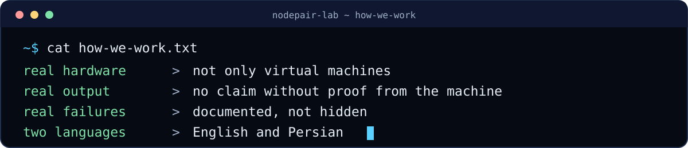
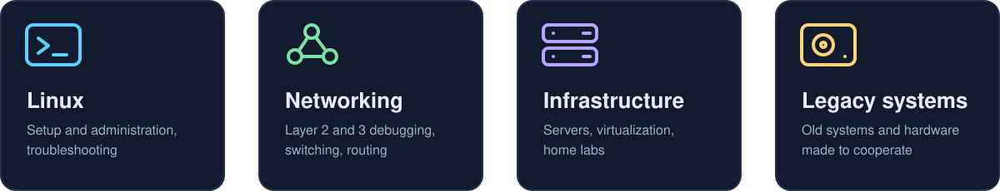
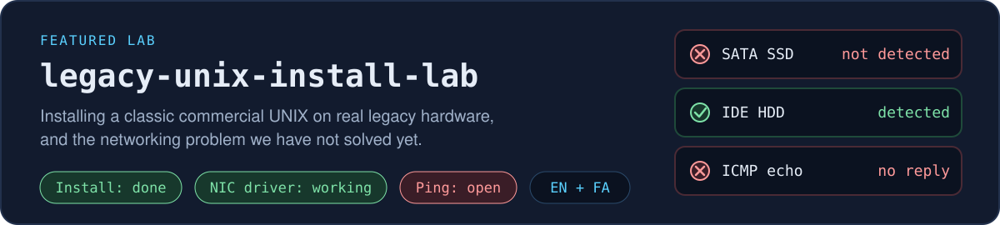
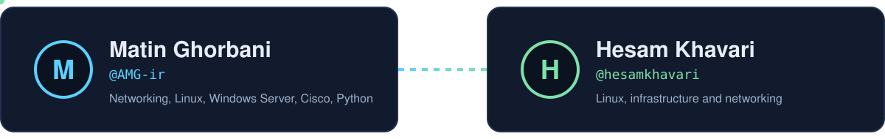

  

  
  

  

## About

We are two computer engineering students who like to build things on real machines, break them, and write down what actually happened, including what we could not solve.

  

## Focus areas

  

  

## Featured lab

## Team

  

  

  Most of our write-ups are licensed under <a href="https://creativecommons.org/licenses/by/4.0/">CC BY 4.0</a>. Share and adapt them, with credit.

